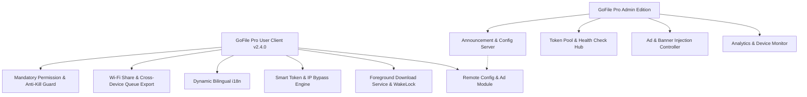

# Design Specification: GoFile Pro v2.4.0 Core Upgrades & Admin APK Edition

## 1. Context & Objectives
This initiative addresses 7 core engineering and product requirements:
1. **Bypass GoFile IP Restrictions & Rate Limits**: Alleviate HTTP 429 rate limits, bypass Indonesian ISP blocking (IndiHome/Telkomsel), add smart exponential backoff, DoH/proxy support, and 1-tap IP refresh helper.
2. **Account Token Optimization**: Fix header inconsistencies (add `Authorization: Bearer` and `Cookie` to all requests), auto-invalidate stale tokens on 401/429, implement token validation test (`/accounts/getAccountDetails`), and support multi-token rotation.
3. **Complete English & Indonesian i18n**: Full translation dictionary parity for all toasts, dialogs, modals, and dynamic components with instant UI re-render on language switch.
4. **Mandatory Storage & Anti-Kill Battery Onboarding**: A user-friendly, responsive startup modal that guides users to grant All Files Access (`MANAGE_EXTERNAL_STORAGE`) and disable battery optimization (`REQUEST_IGNORE_BATTERY_OPTIMIZATIONS`), with reactive real-time status badges.
5. **Sleep-Resilient Downloads & Cross-Device Migration**: Keep CPU/Wi-Fi active during deep sleep via Foreground Service WakeLock and unthrottled background queue processing; expand Wi-Fi Share and add 1-tap Queue Export/Import via QR/text.
6. **Remote Ad Injection & Announcement Architecture**: Client-side remote configuration consumer ready for ad banners, announcements, and anonymous telemetry.
7. **Dedicated Admin APK Branch**: Build a distinct Admin Edition of GoFile Pro with comprehensive analytics dashboard, ad injection controller, token pool manager, and remote config broadcaster, version-synced with the user client.

---

## 2. Technical Architecture & Component Changes

### Component Details:
1. **Client App (`com.gofile.downloader`)**:
   - `android/app/src/main/java/com/gofile/downloader/AndroidDownloaderPlugin.java`:
     - Token header fixes (`Authorization: Bearer` + `Cookie: accountToken`).
     - Token validation API method (`verifyAccountToken`).
     - Retry logic with exponential backoff on HTTP 429.
     - Storage and battery permission status APIs with reactive listeners.
     - Unthrottled download queue processing.
   - `android/app/src/main/java/com/gofile/downloader/DownloadService.java`:
     - Reinforce `PARTIAL_WAKE_LOCK` and `WIFI_MODE_FULL_HIGH_PERF`.
     - Sticky foreground service execution.
   - `ui/js/i18n.js`:
     - Complete dictionary coverage for ID and EN.
     - Event emitter on language switch.
   - `ui/js/api.js` & `ui/js/app.js`:
     - Mandatory permission and battery dialog with auto-detection.
     - Dynamic re-render on language change.
     - IP 429 quick recovery helper.
     - Remote config and ad rendering.
     - Queue export/import for phone-to-phone migration.
   - `ui/css/style.css`:
     - Styling for permission onboarding, ad banners, and transfer modals.

2. **Admin App (`com.gofile.downloader.admin` on branch `admin`)**:
   - Dedicated Admin Dashboard UI (`ui/admin.html` and `ui/js/admin.js`).
   - Telemetry analytics viewer (sessions, devices, downloads, active users).
   - Ad banner and interstitial controller.
   - Token pool manager with live health checks.
   - Config JSON exporter and broadcast server.

---

## 3. Verification & QA Plan
- **QA Gate 1 (Permissions)**: Verify All Files Access and Battery Optimization modal appears on launch if not granted, updates in real-time when granted, and auto-dismisses.
- **QA Gate 2 (Token & IP)**: Test token verification endpoint with guest, valid, and invalid tokens; test 429 rate limit backoff and airplane mode helper.
- **QA Gate 3 (Bilingual i18n)**: Switch between ID and EN in real-time; verify 100% of text updates including toasts, queue cards, and modals.
- **QA Gate 4 (Background & Sleep)**: Verify downloads continue with screen locked/sleeping without dropping speed or disconnecting.
- **QA Gate 5 (Cross-Device)**: Verify Wi-Fi Share and Queue Export/Import QR code functionality.
- **QA Gate 6 (Admin Edition)**: Verify Admin branch builds cleanly with analytics, ad management, and token pool controls.
